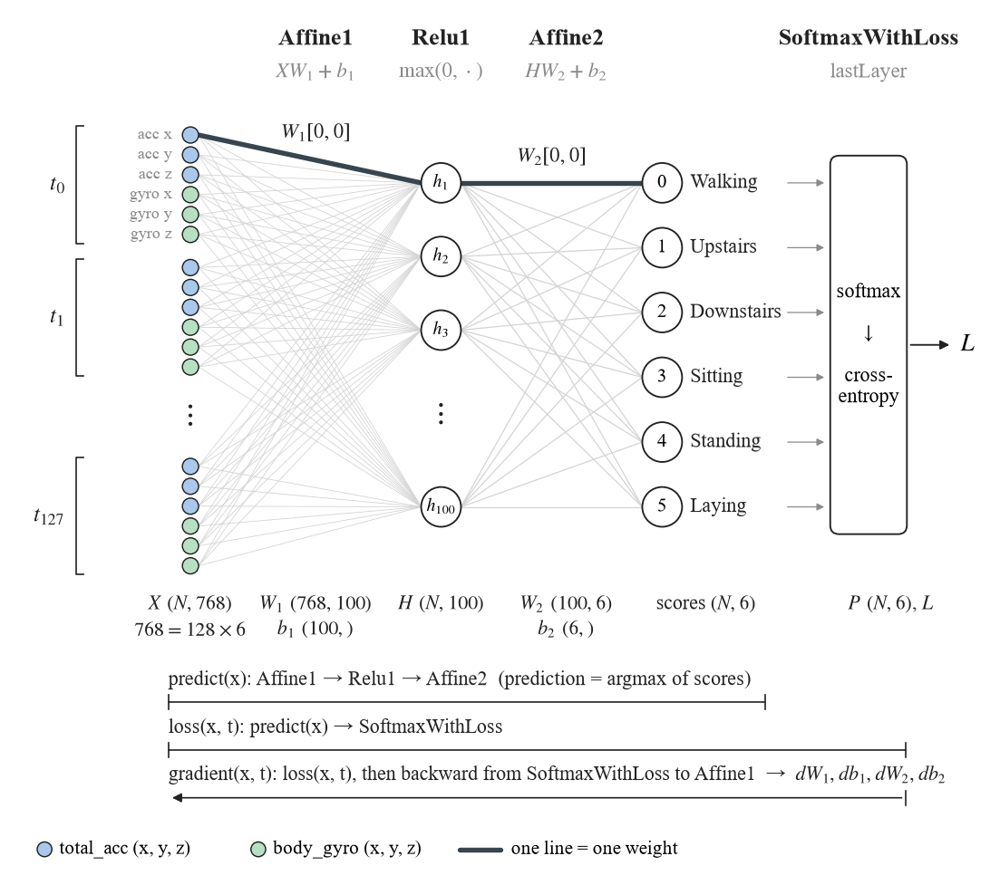
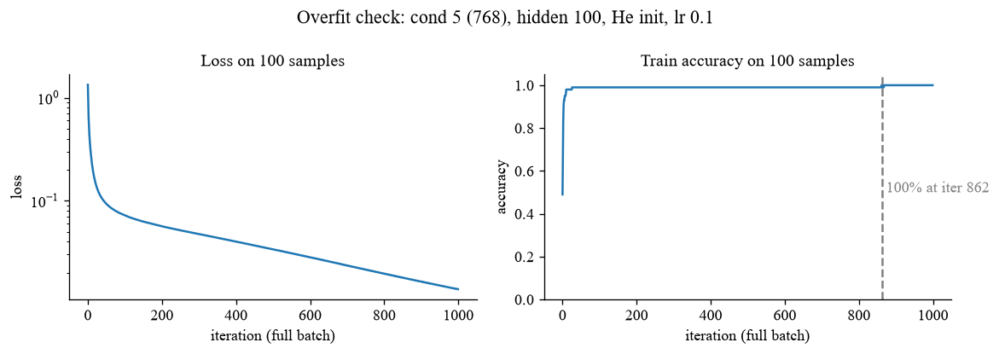
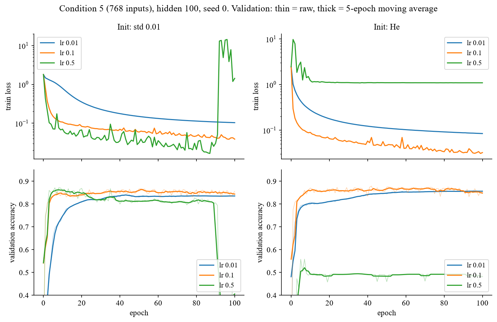
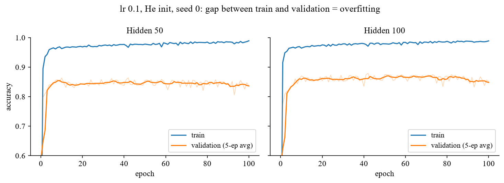
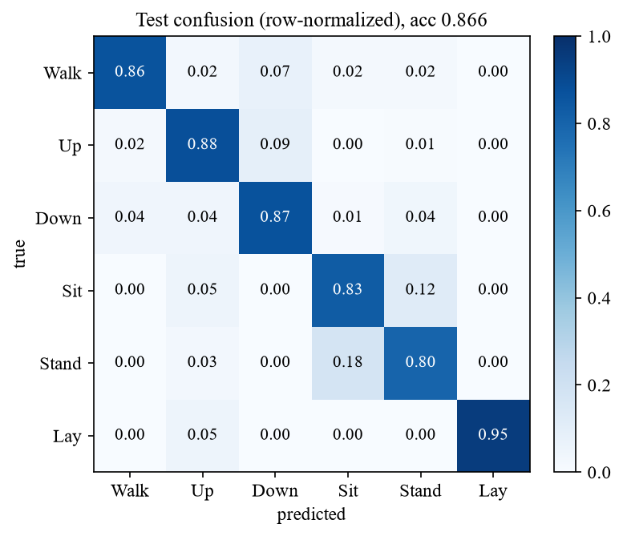

# 🟩 모델 파트 보고서: 구현·검증·학습 설정 (1~3단계)

2026-11-23 · 모델 담당 · 데이터: `data/data.py`, `shared/norm_stats.npz` (커밋 `1450be9`)

**요약**
- NumPy만으로 2층 신경망(768 → 100 → 6)의 순전파·역전파·SGD 학습을 구현하고, 기울기 확인과 100개 과적합 확인을 통과했다.
- 검증 정확도로 학습 설정을 확정했다: 학습률 0.1, He 초기화, 은닉 100, 23 epoch, 배치 100.
- 확정 설정의 테스트 정확도는 87.0% ± 0.5%p (시드 3개)이다. 가장 큰 혼동은 앉기와 서기 사이에서 발생했다.

---

## 1. 구현 및 검증

### 1-1. 구현 원칙
수업 취지에 따라 라이브러리의 자동미분을 쓰지 않았다. 순전파, 손실, 역전파, 가중치 갱신을 모두 NumPy 행렬 연산으로 직접 작성했다. 출발점은 『밑바닥부터 시작하는 딥러닝』 공식 코드이며, 교재 구조를 유지하고 이 데이터에 필요한 부분만 바꿨다.

| 교재 코드 | 우리 코드 | 그대로 쓴 것 | 바꾼 것과 이유 |
|---|---|---|---|
| `common/functions.py` | `layers.py` | `softmax` (최댓값을 빼는 overflow 대책), `cross_entropy_error` | 없음 |
| `common/layers.py` | `layers.py` | `Relu`, `Affine`, `SoftmaxWithLoss`의 forward·backward | `Affine.backward`에 기울기 shape 확인(assert) 추가. CNN용 계층과 `common.util` import는 제외 |
| `ch05/two_layer_net.py` | `model.py` | 계층 구성(`OrderedDict`), `predict`, `loss`, `accuracy`, `gradient` | 시드 고정(`default_rng`): 실험 2의 시드 비교용. 초기화 선택(He / std 0.01): 2절 비교용. 은닉층 출력 `hidden()`: 5단계 분석용. 저장·불러오기: 불러온 뒤 계층을 다시 연결(교재 `Affine`은 `params`와 같은 배열을 참조하므로) |
| `ch05/gradient_check.py`, `common/gradient.py` | `check_gradient.py` | 중앙차분 수치미분 (`h = 1e-4`) | 절대오차 평균 → 파라미터별 상대오차(최대·평균). 손실의 `+1e-7` 처리 (4절) |
| `ch05/train_neuralnet.py` | `train.py` | 미니배치 SGD, 갱신식 `W ← W − lr·dW` | 복원추출 반복 → epoch마다 섞어서 한 바퀴. 테스트 대신 검증 정확도 기록. 설정을 명령줄 인자로 |
| `ch06/weight_init_compare.py`, `ch06/hyperparameter_optimization.py` | `train.py`, `plot_settings.py` | 초기화 비교, 검증 데이터로 설정 선택 | 검증 분할을 무작위 20% 대신 사람 5명 단위로 (`data.py`) |

### 1-2. 모델 구조



- 입력 768개는 128시점 × 6채널(`total_acc` x, y, z와 `body_gyro` x, y, z)을 시점 우선으로 펼친 값이다. 입력 `x[t·6 + c]`는 시점 `t`, 채널 `c`의 정규화된 측정값이다 (`data.flatten`).
- 계층 이름은 `model.py`와 같다. `Affine1`이 `XW₁ + b₁`, `Relu1`이 `max(0, ·)`, `Affine2`가 `HW₂ + b₂`, `SoftmaxWithLoss`가 softmax와 cross-entropy를 계산한다.
- 선 하나가 가중치 하나에 해당한다. `W₁`은 768 × 100개, `W₂`는 100 × 6개이다. 편향 `b₁ (100,)`, `b₂ (6,)`은 노드마다 하나이며, 모든 샘플 행에 같은 값이 더해진다. 파라미터는 모두 77,506개이다.
- `N`은 한 번에 넣는 샘플 수이다. 학습 중에는 배치 크기 100이고, 평가할 때는 해당 데이터 전체이다. 가중치의 모양은 `N`과 관계없다.
- `predict(x)`는 `Affine2`까지 계산하고 점수의 argmax를 예측으로 쓴다. softmax는 점수의 순서를 바꾸지 않으므로 예측에는 필요 없다.
- `loss(x, t)`는 `SoftmaxWithLoss`까지 계산한다. 정답 칸의 확률이 필요하므로 softmax를 거친다.
- `gradient(x, t)`는 `loss`로 순전파를 끝낸 뒤 `SoftmaxWithLoss`부터 `Affine1`까지 역순으로 `backward`를 호출해 `dW₁, db₁, dW₂, db₂`를 얻는다. 갱신은 `train.py`에서 한다.

### 1-3. 기울기 확인 (`check_gradient.py`)
입력 20, 은닉 10, 출력 6의 작은 네트워크에 랜덤 샘플 3개를 넣고, 역전파 기울기와 중앙차분 기울기를 원소별로 비교했다. 통과 기준은 파라미터별 최대 상대오차 1e-5 미만이다.

| 파라미터 | 최대 상대오차 | 평균 상대오차 | 판정 |
|---|---|---|---|
| `W1` (20, 10) | 5.8e-8 | 1.5e-9 | 통과 |
| `b1` (10,) | 1.4e-9 | 3.9e-10 | 통과 |
| `W2` (10, 6) | 4.2e-9 | 1.5e-9 | 통과 |
| `b2` (6,) | 4.1e-9 | 1.3e-9 | 통과 |

대조 실험으로 `Affine.backward`의 `db`를 일부러 2배로 바꾸고 같은 확인을 실행했다. `b1`, `b2`의 최대 상대오차만 0.5로 커졌고 `W1`, `W2`는 변하지 않았다. 이 확인은 오류가 있는 파라미터를 구분해 검출한다. (`b1`은 10개 중 9개만 기준을 넘었다. 남은 1개는 세 샘플 모두에서 ReLU가 0을 출력한 노드로, 기울기가 원래 0이다.)

### 1-4. 100개 과적합 확인 (`check_overfit.py`)
학습 데이터에서 행동별로 16~17개씩 고른 100개만으로 학습했다(은닉 100, He 초기화, 학습률 0.1, 전체 배치). 파라미터 수가 샘플 수보다 훨씬 많으므로, 학습 과정이 정상이면 학습 정확도 100%에 도달해야 한다.



- 862번째 갱신에서 학습 정확도 100%에 도달했다 (통과).
- 27번째 갱신에서 99%에 도달한 뒤 오래 머물렀다. 마지막까지 틀린 1개는 앉기를 서기로 예측한 샘플이었다.
- 이 모델의 검증 정확도는 58.1%이다. 100개만 학습했으므로 낮은 값이 정상이다.

---

## 2. 학습 설정 확정

조건 ⑤(768차원)로 학습하고 **검증 정확도로만** 설정을 골랐다. 테스트 데이터는 설정을 확정한 뒤 한 번만 평가했다. 검증 정확도가 epoch마다 ±2%p 정도 변동하므로, 정점은 5 epoch 이동평균으로 판단했다.

| 설정 | 후보 | 확정 | 근거 |
|---|---|---|---|
| 학습률 | 0.01 / 0.1 / 0.5 | **0.1** | 0.01은 100 epoch까지 검증 정확도가 계속 느리게 올랐다(He 85.7%). 0.5는 두 초기화 모두 학습이 무너졌다 (4절) |
| 초기화 | std 0.01 / He | **He** | 학습률 0.1에서 이동평균 정점 He 87.0%, std 86.4%. 차이가 시드 간 편차(약 1.4%p)보다 작아 ReLU에 맞는 He를 택했다 |
| 은닉 크기 | 50 / 100 | **100** | 시드 0, 1, 2 모두에서 100이 50보다 1.4~1.8%p 높았다 (23 epoch 평균: 86.6% vs 85.1%) |
| epoch | 곡선으로 판단 | **23** | 시드 3개 평균 검증 곡선의 이동평균 정점. 이후 학습 정확도만 오르고 검증 정확도는 내려갔다 (100 epoch: 85.4%) |

배치 크기 100, 최적화 SGD, 정규화 기법 없음. 이 값은 `train.py`의 기본값으로 고정했으며, 실험 2의 모든 조건에 같은 값을 쓴다.



- 위: 학습 loss, 아래: 검증 정확도(옅은 선은 원래 값, 진한 선은 5 epoch 이동평균).
- 학습률 0.1이 두 초기화 모두에서 가장 빠르고 안정적으로 수렴했다.



- 학습 정확도는 약 99%까지 오르고 검증 정확도는 85~87%에 머문다. 두 곡선의 간격(약 11%p)은 과적합의 크기이며, 은닉 50과 100에서 비슷했다.

---

## 3. Baseline 결과

확정 설정으로 시드 3개를 학습하고 테스트 데이터(9명, 2,947개)로 평가했다.

| 시드 | 0 | 1 | 2 | 평균 ± 표준편차 |
|---|---|---|---|---|
| 테스트 정확도 | 86.6% | 87.0% | 87.5% | **87.0% ± 0.5%p** |



- 행은 정답, 열은 예측이며 행별 비율로 나타냈다 (시드 0).
- 가장 큰 혼동은 서기 → 앉기(18%)와 앉기 → 서기(12%)이다. 두 자세는 허리에 찬 폰의 기울기 차이가 작다. 실험 전 예상과 일치한다.
- 걷기, 계단 오르기, 계단 내려가기 사이의 혼동은 2~9%이다.
- 눕기의 정확도는 세 시드 모두 95%였고, 나머지 5%(27개)는 계단 오르기로 예측되었다. 세 시드에서 틀린 27개가 같은 샘플이었고, 모두 테스트 대상자 10번 한 명의 눕기 샘플(58개 중 27개)이었다. 시드와 관계없이 같은 샘플이 틀렸으므로, 이 사람의 눕기 구간이 학습 데이터의 눕기와 다른 입력 분포를 가졌을 가능성이 있다. 이 사람의 원신호(특히 `total_acc`의 중력 방향)는 아직 확인하지 않았다. 실험 2(센서 조합)와 5단계(은닉 표현 분석)에서 확인한다.
- 원신호를 쓴 공개 CNN·LSTM 결과(약 92~93%)보다 낮다. MLP는 입력을 위치가 고정된 768개 값으로 받으므로, 같은 패턴이 다른 시점에 나타나면 다른 입력으로 처리한다 (레포 README 7-1절).

---

## 4. 시행착오

| 증상 | 원인 | 해결 |
|---|---|---|
| 기울기 확인에서 `W1`의 최대 상대오차가 2.4e-5로 기준(1e-5)을 넘었다 | 교재 손실은 `log(0)`을 막기 위해 `−log(y + 1e-7)`을 쓰지만, 역전파 공식 `(y − t)/N`은 `−log(y)`의 미분이다. 두 값은 원소마다 약 `1e-7/y`만큼 다르다 | 수치미분을 `−log(y)`로 계산했다. 최대 상대오차가 5.8e-8로 줄었다. 학습에는 교재 손실을 그대로 쓴다 |
| 100개 과적합 확인이 4번째 갱신에서 바로 끝났다 | 학습 데이터 앞 100개에 계단 오르기·내려가기가 하나도 없었다. 데이터가 사람과 시간 순서로 정렬되어 있다 | 행동별로 고르게 100개를 뽑았다. 100% 도달이 862번째 갱신으로 늦어졌고, 앉기·서기 구분이 가장 늦게 학습되었다 |
| 학습률 0.5에서 학습이 무너졌다 | He: 첫 epoch에 loss가 10까지 올랐고 검증 정확도가 약 49%에 머물렀다. std 0.01: 90 epoch 부근에서 loss가 14까지 급증했다 | 후보에서 제외했다 |

<details>
<summary>실행 방법 (레포 루트에서)</summary>

```bash
python data/data.py               # 처음 한 번 (UCI 원본은 각자 받아 레포 루트에 둔다)
python model/check_gradient.py    # 1-3절
python model/check_overfit.py     # 1-4절
python model/train.py --test      # 확정 설정 1회 (약 10초)
python model/plot_settings.py "c5_h100_lr0.1_he_e23_s{s}"   # 2·3절 그림
python model/plot_network.py      # 1-2절 그림
```
</details>
